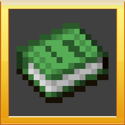
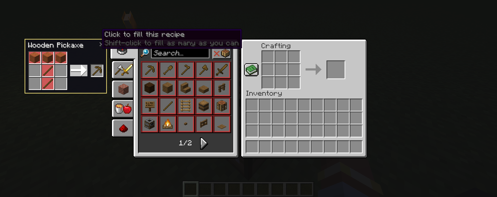
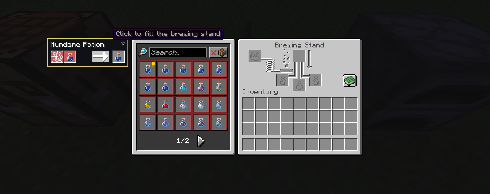
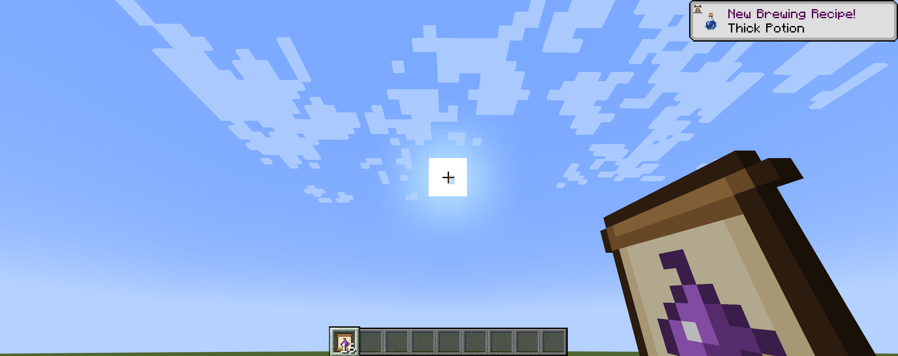

<p align="center">
  
</p>

<h1 align="center">Recipe Codex</h1>

<p align="center">
  Pin recipes beside your inventory, click them to fill the grid, and get a full recipe book for the brewing stand.<br>
  Minecraft 1.21.1 · Fabric and NeoForge
</p>

---

## Features

### Pinned recipes



- **Pin any recipe.** Hover a recipe in the vanilla recipe book and press **B**. Press **B** again to unpin it, or click the **x** on the pin.
- **Only shows up in menus.** Pins appear beside the inventory, crafting table, furnace, blast furnace, smoker and brewing stand. They never show on the in-game HUD.
- **Shows what's missing.** Ingredients you don't have are tinted red.
- **Click to fill.** Clicking a pin in a station that can make it fills the recipe in, the same as clicking it in the recipe book. Shift-click fills as many as you can. Missing items show as a ghost recipe. If a pin belongs to a different station, or needs a 3x3 grid, the tooltip tells you where to make it.
- **Look up missing ingredients.** Click a red ingredient on a pin, or a ghost item in the crafting grid, to pin that ingredient's recipe too. For slots like "any planks" it picks the kind you already have.
- **Shows your selection.** The recipe you clicked in the vanilla recipe book gets a gold outline, the same as in the brewing book.
- Up to 4 pins at once. Pinning a 5th drops the oldest.
- Pins are saved to `config/pinrecipe.json`, so they stay after a restart.
- On small screens the pins switch to a narrower layout, and they hide while the recipe book needs the space.

### Brewing stand recipe book



- Click the green book button on the brewing stand to open a recipe book styled like the vanilla one.
- It lists every brewing recipe you've unlocked. That includes potions, their Long and II versions, splash and lingering conversions, and recipes added by other mods.
- Ingredients that all brew the same thing share one entry. For example, vanilla has 12 ways to make a Mundane Potion from a Water Bottle, and they show as a single recipe that cycles through its ingredients.
- Hover a recipe to see its base bottle, ingredient and effects. Recipes you have the items for get a grey background, and the rest get a red one.
- Search by name, and use the toggle next to the search bar to show all recipes or only the ones you can brew right now.
- Click a recipe to move its bottles and ingredient into the stand. Anything you're missing shows as a ghost item. Hover a ghost to see its name, or click it to look up how to brew it. For example, clicking a ghost Awkward Potion switches the stand to Water Bottle + Nether Wart.
- Press **B** on a brewing recipe to pin it, the same as a crafting recipe.

### Potion Scrolls



- **Crafting:** craft a scroll from **paper + nether wart + glass bottle** (shapeless). The recipe unlocks when you pick up nether wart.
- **Witch drops:** witches killed by a player drop one 10% of the time, plus 5% per level of Looting.
- **Using one:** a scroll teaches you a random brewing recipe you don't know yet, and a **New Brewing Recipe!** toast shows the potion.
- **Using a stack:** sneak while using to read the whole stack at once. You learn one recipe per scroll and get a single summary toast. Once you know every recipe, the leftover scrolls stay in your hand.
- **No restrictions:** unlocks only fill the book. You can still brew anything without unlocking it, just like vanilla's recipe book.
- **Saving:** unlocks are saved per player and kept through death.
- **Master Alchemist:** learning every brewing recipe earns a challenge advancement, listed after "Local Brewery" in the Nether tab.
- **Operator commands:** use `/brewbook unlockall` and `/brewbook reset` for testing.

## Controls

| Action | Default |
| --- | --- |
| Pin or unpin the hovered recipe | **B** (rebind in Options → Controls → Key Binds → Pin Recipe; a mouse button works too) |
| Fill a pinned recipe | Click the pin |
| Fill as many as you can | Shift-click the pin |
| Pin a missing ingredient's recipe | Click the red slot or ghost item |
| Read a whole stack of scrolls | Sneak + use |

## Installation

1. Install [Fabric Loader](https://fabricmc.net/) with [Fabric API](https://modrinth.com/mod/fabric-api), or [NeoForge](https://neoforged.net/) 21.1.
2. Put the matching jar in your `mods` folder.

The mod adds an item, so it needs to be installed on both the server and every client.

## Building from source

Requires Java 21.

```
./gradlew build
```

The jars end up in `fabric/build/libs/` and `neoforge/build/libs/`. Use the one without `-sources` or `-javadoc` in its name.

To run a dev client, use `./gradlew :fabric:runClient` or `./gradlew :neoforge:runClient`.

### Project layout

Based on [jaredlll08/MultiLoader-Template](https://github.com/jaredlll08/MultiLoader-Template).

- `common/`: all of the mod's logic, including pins, the overlay, the brewing book, scrolls, networking and mixins
- `fabric/`: the Fabric entry points and event hooks
- `neoforge/`: the NeoForge entry points and event hooks
- `media/`: the logo and the screenshots used in this README

## License

MIT, by Lucky Owl Studios.
